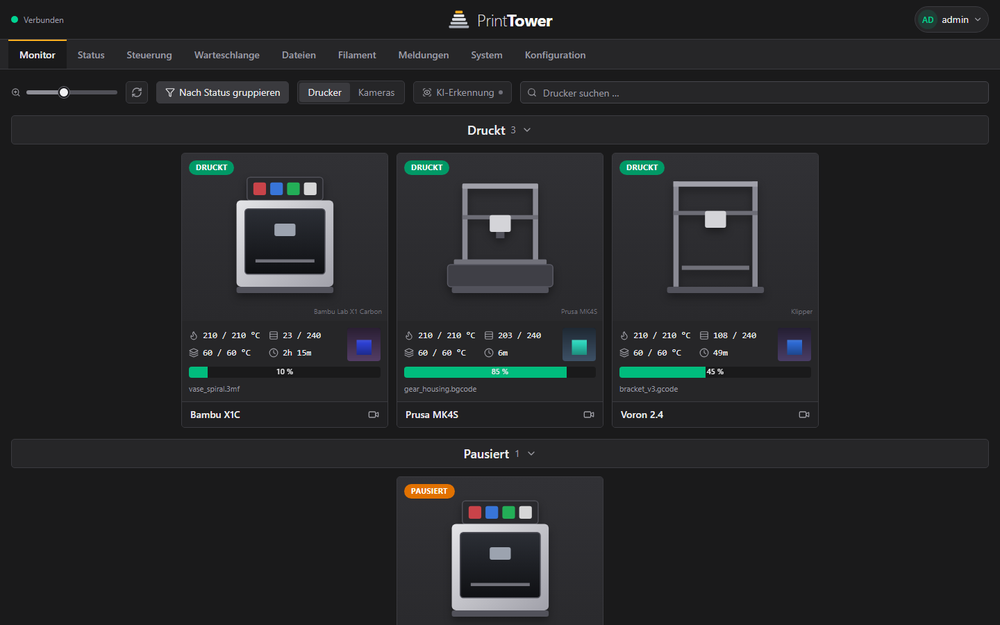
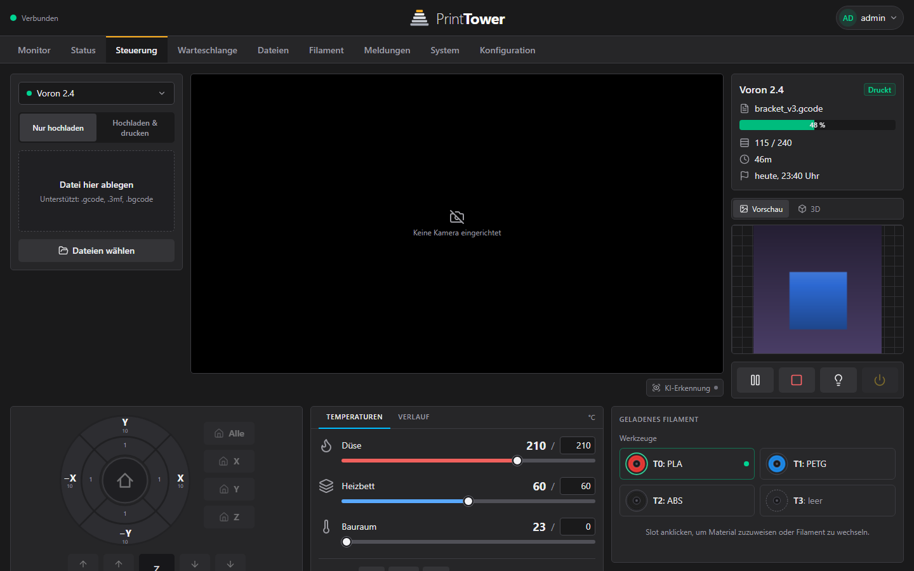
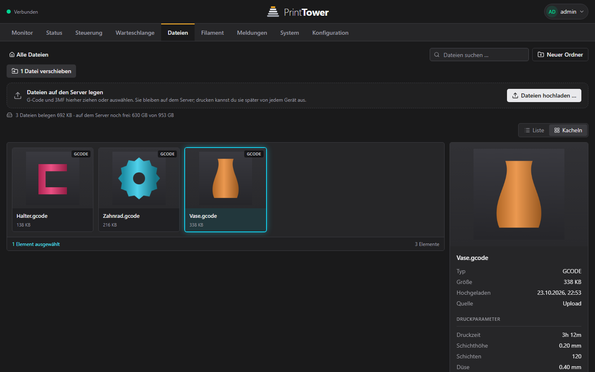
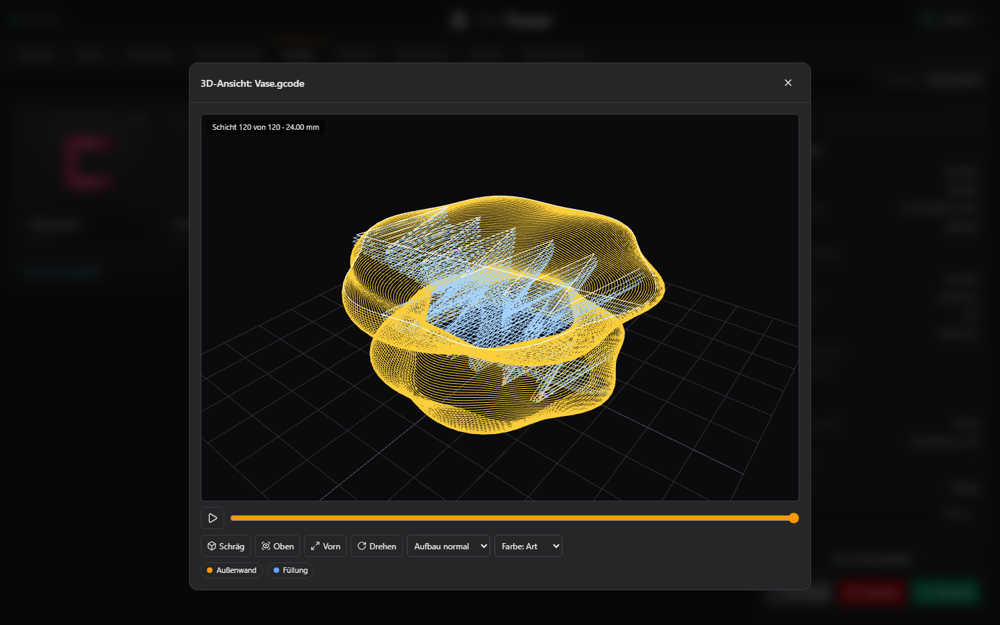
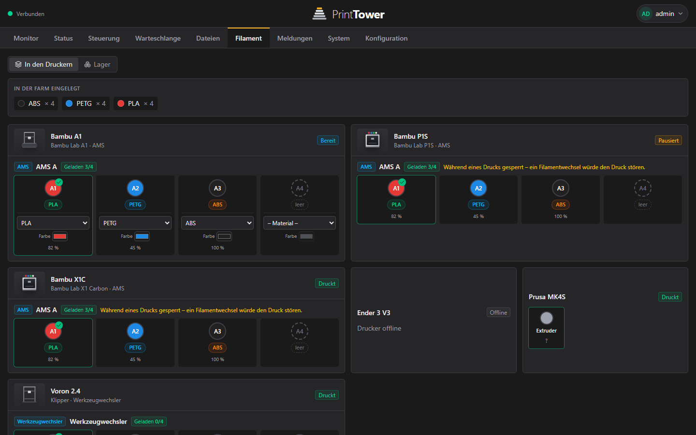
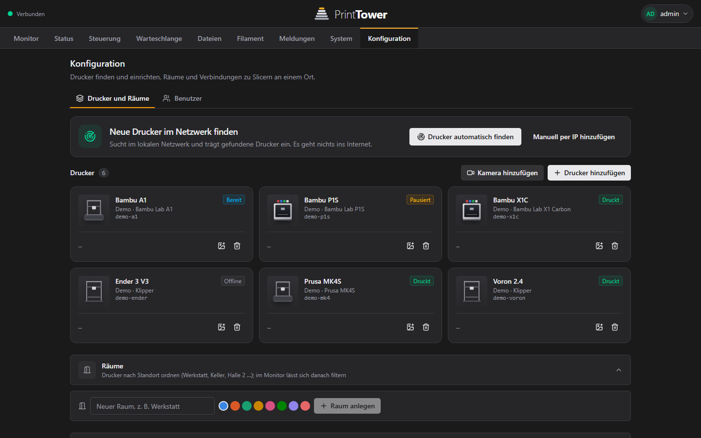
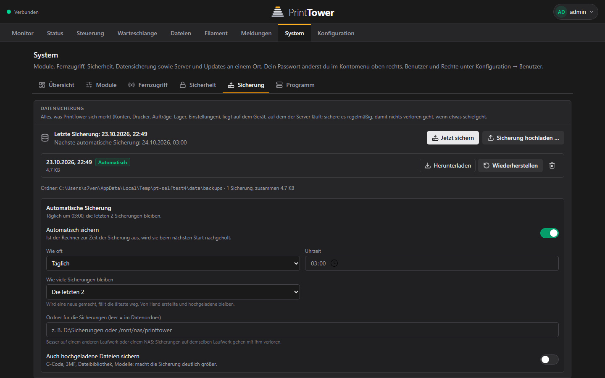

<div align="center">

# PrintTower

**Alle deine 3D-Drucker an einem Ort – ohne Cloud, ohne Konto, ohne Telemetrie.**

Überwachen · Steuern · Aufträge automatisch verteilen · Dateien auf dem Server · 3D-Vorschau

[**⬇ Herunterladen**](https://github.com/S7VENZZ/PrintTower/releases/latest) &nbsp;·&nbsp; [Installation](#installation) &nbsp;·&nbsp; [Funktionen](#was-printtower-kann) &nbsp;·&nbsp; [Unterstützte Drucker](#unterstützte-drucker)

<br>



</div>

---

## Was ist PrintTower?

PrintTower zeigt alle deine 3D-Drucker in **einer** Oberfläche: Status, Fortschritt, Restzeit, Temperaturen und Kamerabild. Du steuerst sie von dort, schickst Druckdateien hin und lässt PrintTower entscheiden, welcher freie Drucker sie bekommt.

Alles läuft **auf deiner eigenen Hardware** (Windows-PC, Raspberry Pi, Mac oder Linux-Rechner). Es gibt keinen Cloud-Dienst, kein Konto bei uns und keine Messdaten. Bedient wird PrintTower mit der **PrintTower-App** (Windows, Mac, Linux, Android).

---

## Was PrintTower kann

<table>
<tr>
<td width="46%" valign="top">

### 🖨️ Alle Drucker auf einen Blick
Live-Status, Fortschritt und Restzeit aller Drucker, gruppiert nach Status oder Raum. Ein Klick öffnet die Steuerung.

</td>
<td width="54%"></td>
</tr>
<tr>
<td width="46%" valign="top">

### 🎛️ Steuern wie vor Ort
Achsen bewegen, Temperaturen und Lüfter einstellen, Filament wechseln, Licht schalten, Druck pausieren oder abbrechen. Dazu das **Live-Kamerabild** und die **3D-Ansicht** des laufenden Drucks, Schicht für Schicht.

</td>
<td width="54%"></td>
</tr>
<tr>
<td width="46%" valign="top">

### 📁 Dateien auf dem Server
Lade G-Code und 3MF **einmal** auf den Server und drucke sie später von jedem Gerät aus. Mit Ordnern, Vorschaubild, Druckparametern und Speicheranzeige.

</td>
<td width="54%"></td>
</tr>
<tr>
<td width="46%" valign="top">

### 🔍 Vor dem Drucken in 3D ansehen
Jede abgelegte Datei lässt sich als 3D-Ansicht öffnen: drehen, zoomen, den Aufbau Schicht für Schicht abspielen. So siehst du vorher, was herauskommt.

</td>
<td width="54%"></td>
</tr>
<tr>
<td width="46%" valign="top">

### 🧵 Filament-Lager
Was ist in welchem Drucker eingelegt, wie viel ist noch drauf, welche Spulen liegen im Regal. Aufträge gehen nur an Drucker mit passendem Material.

</td>
<td width="54%"></td>
</tr>
<tr>
<td width="46%" valign="top">

### ⚙️ Einfach einrichten
Drucker im Netzwerk **automatisch finden lassen**, Räume anlegen, Slicer verbinden. Alles auf einer Seite.

</td>
<td width="54%"></td>
</tr>
<tr>
<td width="46%" valign="top">

### 💾 Sicherung und Updates
Tägliche **automatische Sicherung** (ab Werk um 03:00, die letzten 2 bleiben – einstellbar). **Updates für App und Server** mit einem Klick, signiert und geprüft.

</td>
<td width="54%"></td>
</tr>
</table>

### Außerdem

- **Warteschlange:** Dateien einreihen, PrintTower verteilt sie an den nächsten freien, passenden Drucker. Serien-Druck und Mehrplatten-3MF.
- **KI-Fehlererkennung:** erkennt Spaghetti im Kamerabild und pausiert den Druck.
- **Meldungen:** Alarmzentrale für alles, was auf der Farm passiert. In der **Android-App** kommen sie auch als Benachrichtigung aufs Handy (Druck fertig, Fehler …), ohne Google und ohne fremden Server.
- **Speicher aufräumen:** alte Dateien nach einstellbarer Zeit automatisch löschen (ab Werk aus, Ordner bleiben tabu, die Statistik bleibt).
- **Anmeldung mit Rollen:** Administrator, Bediener, Betrachter; Zugriff je Drucker oder Raum; optional Zwei-Faktor.
- **Verschlüsselt:** HTTPS mit eigener Zertifizierungsstelle, ohne Let's Encrypt und ohne Cloud.
- **Virtueller Drucker:** direkt aus dem Slicer (OrcaSlicer, Bambu Studio) drucken.
- **Fernzugriff:** eigenes VPN (WireGuard), auf Wunsch Cloudflare Tunnel oder Tailscale.

---

## Unterstützte Drucker

| Familie | Beispiele | Anbindung |
|---|---|---|
| **Klipper** | Voron, Creality K1 / K2, Ender mit Klipper | Moonraker |
| **Bambu Lab** | X1, P1, A1 | LAN-Modus (nicht die Bambu Cloud) |
| **Prusa** | MK4 / MK4S, MK3.9, MINI, XL, Core One | PrusaLink |
| **OctoPrint** | alle mit OctoPrint, auch Prusa MK3 am Raspberry Pi | OctoPrint-Schnittstelle |

Nicht unterstützt: Prusa Connect und die Bambu Cloud (beides Cloud-Dienste, das widerspricht dem lokalen Ansatz).

---

## Installation

PrintTower besteht aus zwei Teilen:

| Teil | Aufgabe | Wo |
|---|---|---|
| **Server** | läuft rund um die Uhr, überwacht die Drucker, speichert Dateien | Windows-PC, Raspberry Pi, Mac oder Linux |
| **App** | zum Bedienen, zeigt den Server an | Windows, macOS, Linux, Android |

Die App findet den Server im selben Netzwerk von selbst.

### Windows – am einfachsten (Server und App in einem)

1. Auf der [Download-Seite](https://github.com/S7VENZZ/PrintTower/releases/latest) die Datei **`PrintTower-Setup-<Version>-win-x64.exe`** laden.
2. Ausführen. Windows warnt, weil das Programm nicht signiert ist: **„Weitere Informationen“ → „Trotzdem ausführen“**. Administratorrechte brauchst du nicht.
3. PrintTower starten, **Administrator-Konto anlegen**, dann **„Drucker automatisch finden“**.

Das war es. Der Server läuft im Hintergrund weiter, auch wenn du das Fenster schließt.

### Raspberry Pi – oder anderer Server (Linux, Mac)

Ein Raspberry Pi (64-Bit-System) ist ideal als Server, der immer an ist. Im Terminal des Pi:

```sh
curl -fsSL https://github.com/S7VENZZ/PrintTower/releases/latest/download/install.sh | sudo sh
```

Das Skript installiert Node.js (falls nötig), lädt den **signierten** Server, richtet den Dienst ein und startet ihn beim Hochfahren. Danach öffnest du auf deinem Windows-PC oder dem Handy die **PrintTower-App** und wählst den Server aus.

Auf einem Mac geht der Befehl genauso (ohne `sudo` läuft der Server als Dienst deines Benutzers).

Die **App** (Windows, Mac, Linux oder Android) findet den Server dann im Netzwerk von selbst.

### Windows als reiner Server (ohne App)

```powershell
irm https://github.com/S7VENZZ/PrintTower/releases/latest/download/install.ps1 | iex
```

### Mac (macOS)

1. Auf der [Download-Seite](https://github.com/S7VENZZ/PrintTower/releases/latest) die passende Datei laden: **`PrintTower-Setup-<Version>-mac-arm64.dmg`** für Macs mit Apple-Chip (M1 bis M4), **`…-mac-x64.dmg`** für ältere Macs mit Intel.
2. Öffnen und PrintTower in den Ordner „Programme“ ziehen.
3. Die App ist nicht signiert, macOS blockiert sie deshalb beim ersten Start: **Rechtsklick auf PrintTower → „Öffnen“ → „Öffnen“**. Meldet macOS „beschädigt“, im Terminal einmal `xattr -cr /Applications/PrintTower.app` ausführen.
4. Beim Start Administrator-Konto anlegen, oder (wenn dein Server schon auf einem Pi läuft) **„Mit einem anderen Server verbinden“**.

### Linux (Desktop)

- **AppImage:** `PrintTower-Setup-<Version>-linux-x86_64.AppImage` laden, ausführbar machen (`chmod +x …`) und starten.
- **Debian/Ubuntu:** `PrintTower-Setup-<Version>-linux-amd64.deb` laden und mit `sudo apt install ./PrintTower-Setup-<Version>-linux-amd64.deb` installieren.

(Für Raspberry-Pi-Desktops mit ARM-Prozessor gibt es die App noch nicht; dort läuft der Server, und bedient wird er von Windows, Mac, Linux-PC oder Android.)

### Android

1. Öffne in der App **System → Fernzugriff → „PrintTower aufs Handy“**, wähle **Android** und scanne den QR-Code mit der Handy-Kamera – oder lade [**`PrintTower-android.apk`**](https://github.com/S7VENZZ/PrintTower/releases/latest/download/PrintTower-android.apk) direkt.
2. Öffnen und die Installation erlauben („Apps aus dieser Quelle“).
3. In der App die Adresse deines Servers eintragen (steht in derselben Karte). Die App fragt einmal nach der Erlaubnis für Benachrichtigungen: damit kommen **Meldungen** (Druck fertig, Fehler …) auch bei geschlossener App aufs Handy.

### iPhone

Die iPhone-App gibt es **noch nicht**: Sie lässt sich nur auf einem Mac bauen und braucht ein Apple-Entwicklerkonto für den App Store. Das Projekt ist vorbereitet.

---

## Updates

In der App unter **System → Programm**: **„Nach Updates suchen“** prüft **App und Server** zusammen. Gibt es Neues, aktualisierst du beides mit **„Alles aktualisieren“** oder einzeln. (Die App aktualisiert sich selbst unter Windows; auf Mac und Linux zeigt sie die neue Version an, die du dann von der Download-Seite lädst.) Updates sind **signiert** (Ed25519) und werden vor der Installation geprüft; kommt der Server nach einem Update nicht hoch, geht er von selbst auf die alte Version zurück. Deine Daten bleiben dabei erhalten.

## Datenschutz und Sicherheit

- Läuft **komplett lokal**. Keine Cloud, keine Telemetrie, kein Konto bei Dritten.
- Ins Internet geht nur die Suche nach Updates (zwei kleine Dateien von GitHub, ohne Daten über dich oder deine Drucker; abschaltbar) und, bei Bedarf, der einmalige Download des Kamera-Hilfsprogramms go2rtc für WebRTC-Kameras wie die des Creality K2.
- Bedienung **nur über die App**, nicht im Browser. Ein Browser im Netzwerk bekommt nur einen Hinweis.
- Zugangsdaten werden verschlüsselt gespeichert, Passwörter mit scrypt; optional Zwei-Faktor-Anmeldung.

## Prüfsumme prüfen (optional)

```powershell
(Get-FileHash .\PrintTower-Setup-<Version>-win-x64.exe -Algorithm SHA256).Hash.ToLower()
```

Der Wert steht in der Datei `printtower-update.json` desselben Releases.

---

Dieses Repository enthält die **fertigen Programme** (Installer für Windows, Mac und Linux, Server-Paket, Android-App) und die signierten Update-Beschreibungen. Fragen oder Fehler? Bitte als [Issue](https://github.com/S7VENZZ/PrintTower/issues) melden.
